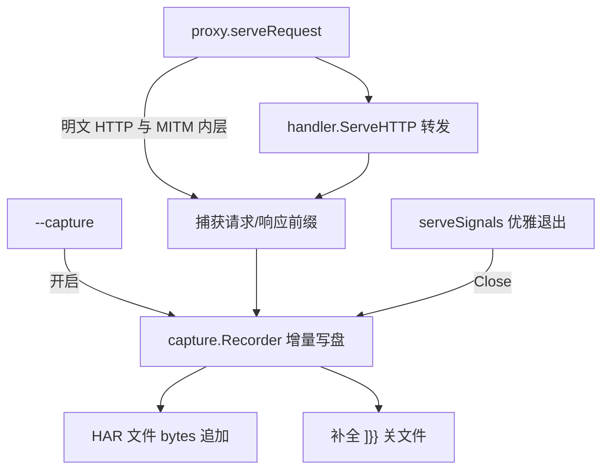

# HAR Capture

Feature Name: capture
Updated: 2026-11-09

## Description

为 mrp 增加抓包能力：把代理可见的明文 HTTP 交互（MITM 解密后的内层请求与客户端直连的明文请求）记录为 HAR 1.2 文件。抓包开关与输出文件在启动时通过 `--capture` 参数确定，开启时以增量写入的方式持续追加 entry，正常退出时补全 JSON 尾部；关闭时走与现状完全一致的路径，零额外开销。转发行为不因抓包开启而有任何改变。

## Architecture



抓包只挂在 `serveRequest` 这一条请求路径上：明文 HTTP 直接进入，MITM 解密后的内层请求复用了同一个 `Handler`，因此两路明文流量天然汇聚到同一入口。CONNECT 建立（`mitm started` / `tunnel started`）与 tunnel 字节搬运都发生在 `serveRequest` 之外，不产生 entry，也无捕获代码。

## Components and Interfaces

### 新包 `internal/capture`（无内部依赖）

纯标准库实现（`encoding/json`、`bufio`、`os`、`sync`），与 `cache`、`log` 同级，`proxy` → `capture` 单向依赖。

```go
// Recorder 把 HAR entry 增量追加到文件：打开时写头部，Record 追加一条，Close 补全尾部。
type Recorder struct {
    file    *os.File
    writer  *bufio.Writer
    mu      sync.Mutex
    wroteAny bool
    bytes   int64   // 累计写入字节数，达上限后停用
    stopped bool    // 上限触发或 IO 失败后停用，Record 直接短路
}

func New(path string, limit int64) (*Recorder, error)
func (r *Recorder) Record(e Entry) error
func (r *Recorder) Close() error
func (r *Recorder) Path() string
```

停用不设独立 `Stop`：`Record` 在序列化或写盘失败、以及累计字节达到 `limit` 时内部置 `stopped`（首次返回错误，此后短路返回 nil），避免调用方重复告警。

- `New`：`os.Create` 截断同名文件，写 HAR 头 `{"log":{"version":"1.2","creator":{"name":"mrp","version":"1.0.0"},"pages":[],"entries":`。创建失败返回 error，由调用方降级为「仅告警、抓包关闭」。
- `Record`：加锁序列化单条 entry，非首条先写 `,`，追加字节并累计大小；达到文件大小上限返回专用错误并置 `stopped`，之后 Record 直接返回 nil 短路。
- `Close`：写尾部 `]}}`，flush 并关闭；幂等，`Stop` 之后仍可补尾。

### `internal/capture/har.go` 结构体

按 HAR 1.2 schema 定义 entry/request/response/postData/content 等结构体，`omitempty` 控制可选字段。body 的原始大小记入 `bodySize`，实际记入前缀大小记入 `postData.text` / `response.content.size`；截断时附 `_truncated` 私有扩展字段（前缀为 `_` 的字段被标准工具忽略，供脚本识别）。

- 目标域名记入 `entry.serverIPAddress`，客户端地址记入扩展字段 `entry._clientAddress`（`request.RemoteAddr` 原始值）。
- 同名多值头逐个展开为 `{name,value}` 列表（`http.Header` 逐条遍历）。

### `internal/proxy/proxy.go` 改动

- `Proxy` 增加 `capture *capture.Recorder` 字段（可能为 nil）。
- `New` 签名不变；新增构造后置方法 `SetCapture(*capture.Recorder)`，或由 `main` 在 `New` 之后注入并传入 `--capture` 路径的创建结果。注入失败（文件不可创建）时 `main` 落一条 `log.Warn` 并传 nil，代理照常转发。
- 暴露 `func (p *Proxy) Close() error`：`capture != nil` 时调用其 `Close()`，供优雅退出补全 JSON。

### `serveRequest` 捕获与转发

请求体在转发前同步读取前缀（最多 body 上限 1 MiB，多读 1 字节判定截断），用 `io.MultiReader` 把前缀拼回原 reader 保持完整转发：

```go
prefix, request.Body = captureRequestBuffer(request, bodyLimit)
// request.Body 换成 io.NopCloser(io.MultiReader(bytes.NewReader(prefix), 原 body))
```

响应用 `captureWriter`（新增，`internal/proxy` 内部）包装 `ResponseWriter`，tee 记录 status、首次 header 与 body 前缀（第 N 字节后丢弃），同时透传 `WriteHeader`/`Write`/`Flush`/`Unwrap` 语义。抓包关闭时不创建 `captureWriter`，路径与现状完全一致（仍用 `frontend.StatusRecorder`）。

defer 段在响应回传后组装 entry（startedDateTime、耗时、method、url、httpVersion、请求/响应头、body 前缀、状态码、客户端地址、目标域名）并调用 `capture.Record`；`Record` 返回上限/失败错误时落一条 `log.Warn`（每条仅一次，用 `Stop` 语义去重）并停用。

### `cmd/mrp/main.go` 改动

- `startupOptions` 增加 `capturePath string`，`parseStartupOptions` 注册 `--capture`（默认空串，空即关闭）。
- `buildProxy` 后：`opts.capturePath != ""` 时 `capture.New(path)`，失败 `log.Warn("capture disabled path=%s err=%v", ...)`；成功 `log.Info("capture started path=%s", path)` 并注入 Proxy。
- `serveSignals` 正常退出路径（`shutdown complete` 与 `shutdown timed out` 分支前）调用 `proxyInstance.Close()` 补全 HAR。强杀无 Close，README 说明手工补尾。

## Data Models

| 字段 | 来源 | 说明 |
|------|------|------|
| `entry.startedDateTime` | 请求到达 `serveRequest` 的 `time.Now().UTC()` | ISO 8601 毫秒 |
| `entry.time` | `time.Since(start)` | 总耗时 ms |
| `request.method/url/httpVersion` | `http.Request` | 客户端实际值 |
| `request.headers` | `request.Header` | 逐条多值展开 |
| `request.bodySize` / `postData.text` | body 前缀读取 | 原生大小 / 记录前缀 |
| `response.status/statusText/httpVersion` | `captureWriter` | 状态码 + `http.StatusText` |
| `response.content.size/text` | 响应 tee | 记录前缀大小 / 前缀 |
| `entry.serverIPAddress` | `domain` | 目标域名 |
| `entry._clientAddress` | `request.RemoteAddr` | 客户端地址扩展字段 |

内置常量：`bodyLimit = 1 MiB`、`fileSizeLimit = 256 MiB`，初版不做成配置项。

## Correctness Properties

1. 抓包关闭时请求路径与引入本功能前字节一致（零分配、无 tee、无额外 IO）。
2. 记录动作发生在响应回传之后，且只读请求/响应副本，不改变状态码、头与 body。
3. `Pick`/`Has` 的匹配结论与是否开启抓包无关。
4. 同一连接多次交互逐次独立成 entry；并发连接经 `Recorder.mu` 串行写盘，单条 entry 完整不交错。
5. 正常退出（SIGINT/SIGTERM）后文件为合法 JSON；强杀时可用 README 描述的手工补尾。
6. 文件达 256 MiB 或 IO 失败后 `stopped`，后续 Record 短路，转发不受影响。

## Error Handling

| 场景 | 行为 |
|------|------|
| `--capture` 文件不可创建 | `log.Warn` 一次，抓包关闭，正常转发 |
| 单条 Record 写失败 / 文件达上限 | `log.Warn` 一次，`Stop` 停用，正常转发；优雅退出仍补尾 |
| 响应的 `Hijack` 路径（CONNECT） | 不经过 `serveRequest` 记录点，天然无 entry |
| 请求 body 无法读取 | 记入空前缀，转发保留 `bodySize` 为可得的原始大小，不中断转发 |

## Test Strategy

- `internal/capture/capture_test.go`：`New` 头、`Record` 首条/次条的逗号、`Close` 尾部补全、并发 `Record` 串行不交错、达 `fileSizeLimit` 后短路、`Close` 幂等、写失败后 `Stop`。
- `internal/proxy/proxy_test.go`：开启抓包后 `--capture` 文件含完整 entry（method/url/status/body 前缀/header 多值）、body 超上限截断且转发完整、响应回传后才写盘、抓包关闭时无文件产生。
- `internal/proxy/connect_test.go`：MITM 内层请求被记录、tunnel 流量与 CONNECT 建立不产生 entry。
- `cmd/mrp/main.go` 相关：`--capture` 解析（缺省关闭、显式开启）、文件不可创建降级告警。
- `go test ./...` 全量回归，`gofmt`、`go vet` 通过。

## References

[^1]: (Filename#L153) - `serveRequest` 明文交互入口 `internal/proxy/proxy.go`
[^2]: (Filename#L67) - MITM 内层复用 `p.Handler()` `internal/proxy/connect.go`
[^3]: (Filename#L85) - tunnel 字节搬运不产生记录的路径 `internal/proxy/connect.go`
[^4]: (Filename#L115) - HAR 结构体与写入器 `internal/capture/capture.go`