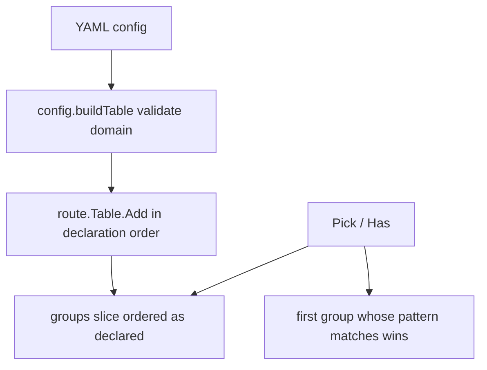

# Domain Wildcard Matching

Feature Name: domain-wildcard
Updated: 2026-11-09

## Description

为 YAML 配置的 `domain` 字段引入通配符匹配：`*` 匹配任意域名，`*.suffix` 按 RFC 1034 语义匹配单层子域（不匹配裸域、不匹配多层子域）。精确域名优先于通配符，长 suffix 优先于短 suffix。`internal/route/route.go` 的 `Table.Pick` 与 `Table.Has` 共用同一匹配结果，保证 HTTP 路由与 CONNECT MITM 判定一致。

## Architecture



配置加载链路不变：`config.Load` → `buildTable` → `Table.Add` → `InstallHandlers` → `Proxy.reload` 整体替换。通配符解析与匹配收敛在 `route` 包内，`config` 只做格式校验，`proxy` 与 `connect` 零改动。

## Components and Interfaces

### internal/config/config.go

- `buildTable` 内新增 domain 格式校验：归一（小写、去空白）后，值必须为精确域名、`*` 或 `*.suffix`；其余含 `*` 形态返回错误。错误消息包含原始 domain 值。
- `Server.Domain` 的 yaml 键保持 `domain`，`buildTable` 传给 `table.Add` 的是归一后的完整字符串（含 `*`），route 包自行解析模式。

### internal/route/route.go

- `Table` 从按域名索引的 map 改为保留声明顺序的分组切片：

```go
type Table struct {
    groups []*DomainGroup // 按 YAML servers 声明顺序
}

type DomainGroup struct {
    pattern  string   // 归一后的 domain 配置值（含 *）
    suffix   string   // 通配符后缀，pattern 为 * 时为 ""；精确分组为 ""
    wildcard bool     // pattern 含 * 时为 true
    entries  []*Entry // 同一 domain 值下的多条 (protocol, port) 条目
}
```

- `Add(domain string, entry *Entry, routes []*Route) error` 签名不变：
  - 按归一 domain 值查找已有分组：找到 → 校验同分组 (protocol, port) 唯一后追加条目。
  - 找到通配符 domain 值 → 解析为 suffix（`*` → `""`，`*.suffix` → suffix），`wildcard` 置 true。
  - 找到精确 domain 值 → `wildcard` 为 false，`pattern` 即域名。
  - 新建分组 append 到 `groups` 尾部，声明顺序即匹配顺序。
- 匹配入口收敛为分组级判定：

```go
func (g *DomainGroup) matches(protocol string, port int, domain string) bool
```

  精确分组要求 `pattern == domain`；通配符分组要求 `wildcardMatch(domain, suffix)`；再叠加既有 `entry.matches`。
- `Pick` 与 `Has` 按声明顺序遍历 `groups`，第一个 `matches` 的分组生效：`Pick` 在其条目内做最长前缀匹配，`Has` 直接返回 true。
- 单层语义判定 `wildcardMatch(domain, suffix)`：
  - `domain == ""` → false。
  - suffix 为空（`*`）→ true。
  - `strings.HasSuffix(domain, "."+suffix)` 为 false → false。
  - 前缀部分 `domain[:len(domain)-len(suffix)-1]` 含 `.` → false（拒绝多层子域）；为空 → false（拒绝裸域）。
- `InstallHandlers` 遍历 `groups`；`Fingerprint` 按声明顺序输出域名模式与条目（顺序变化反映到指纹，正确触发重载）。

### internal/proxy（零改动）

- `connect.go` 的 MITM 判定沿用 `Table.Has`，通配符命中后按 CONNECT 目标域名签发证书（`mitmTLSConfig` 回填 SNI 已支持任意名字）。
- 命中通配符虚拟服务器但路径未命中路由时，HTTP 内层请求仍走 `passthrough`（现状语义，`proxy.go` 的 `routeHandler`）。

## Data Models

| 值 | 分组 | suffix | 命中示例（protocol/port 筛选通过后） |
|----|------|--------|-------------------------------------|
| `example.com` | 精确 | - | 仅 `example.com` |
| `*.example.com` | 通配 | `example.com` | `a.example.com`；排除 `a.b.example.com`、`example.com` |
| `*` | 通配 | `""` | 任意域名，含 IP 字面量与 `deep.a.b.com` |

优先级：YAML `servers` 声明顺序即匹配顺序，先声明先生效；通配符与精确域名遵循同一规则。

## Correctness Properties

1. 精确域名在无通配符配置时的命中结果与引入通配符前完全一致（回归不变量）。
2. `Table.Pick` 与 `Table.Has` 对同一 (protocol, port, domain) 的命中结论一致。
3. 任一请求域名至多选用一个虚拟服务器分组；多组命中时按声明顺序唯一确定。
4. `Fingerprint` 对相同配置内容产出相同指纹，且配置声明顺序变化会改变指纹。
5. 同一分组内 (protocol, port) 组合唯一。

## Error Handling

| 场景 | 行为 |
|------|------|
| domain 含非法 `*` 形态（`a.*.com`、`*example.com`、`*.*`、`*.`、`**`） | `config.Load` 报错，热加载保留旧表 |
| 同一 domain 值 + (protocol, port) 重复 | `Table.Add` 报错，语义与精确域名重复一致 |
| 通配符配置无 CA 证书时 CONNECT 命中 | 沿用现状：502 + `mitm skipped` 日志 |

## Test Strategy

- `internal/route/route_test.go`：`wildcardMatch` 单元测试（单层/裸域/多层/IP/空域）；`Table.Pick` 按声明顺序优先级矩阵（通配符先声明先命中、精确后声明仍被先声明的通配符截获）；`Table.Has` 与 `Pick` 一致性；同组重复报错；`Fingerprint` 按声明顺序且顺序变化改变指纹。
- `internal/config/config_test.go`：合法值（精确、`*`、`*.suffix`、大小写空白归一）与非法值（各非法 `*` 形态）的 `Parse`/`buildTable` 测试。
- `internal/proxy/connect_test.go`：通配符配置下 CONNECT 走 MITM 并按目标域名签发证书（`testutil.AuthorityCA` 现场生成），未命中域名仍透传。
- `go test ./...` 全量回归，`gofmt`、`go vet` 通过。

## References

[^1]: (Filename#L98) - `Table.Pick` 精确匹配现状 `internal/route/route.go`
[^2]: (Filename#L114) - `Table.Has` MITM 判定现状 `internal/route/route.go`
[^3]: (Filename#L86) - `Table.Add` 重复校验现状 `internal/route/route.go`
[^4]: (Filename#L51) - CONNECT 分流 `internal/proxy/connect.go`
