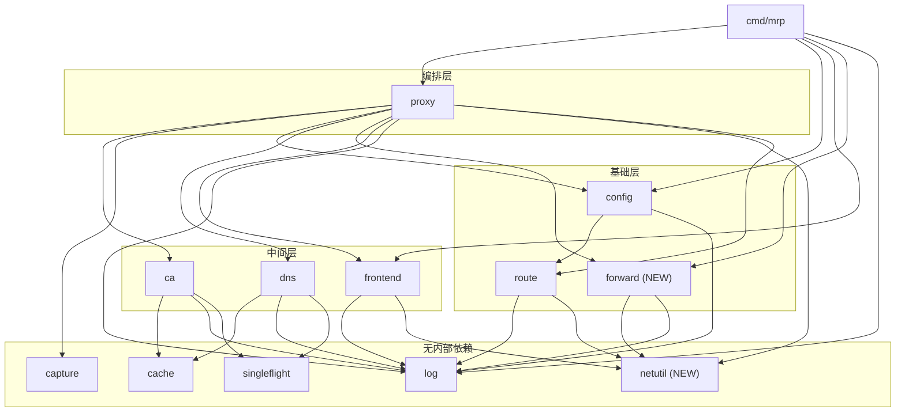
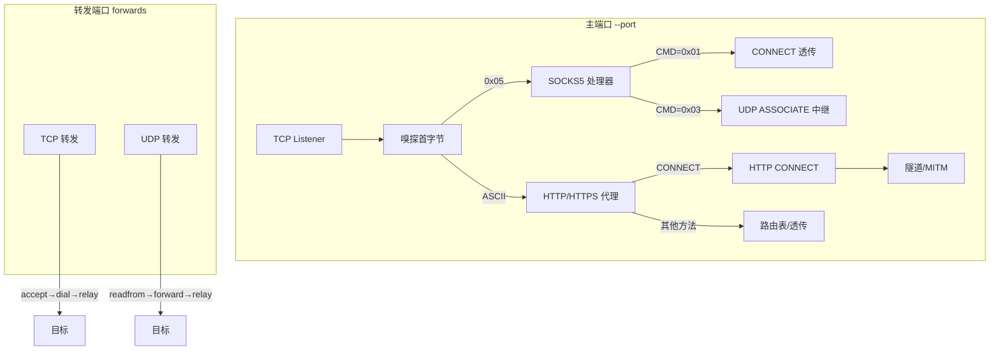
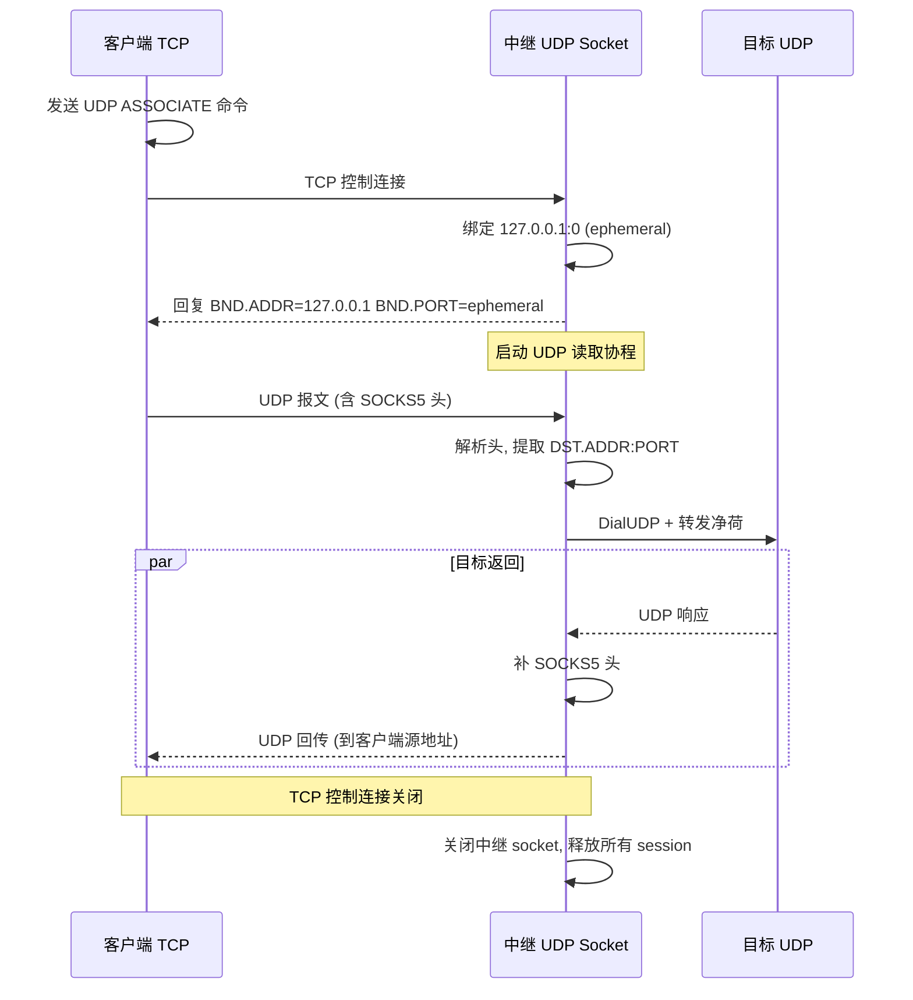

# UDP/TCP Forwarding & Refactor

Feature Name: udp-tcp-forwarding-refactor
Updated: 2026-11-13

## Description

扩展 mrp 至 UDP 领域：实现 SOCKS5 UDP ASSOCIATE、TCP/UDP 端口转发，并在过程中提取共享的 dial+relay、Accept 循环与 buffer pool 为独立组件，消除三处重复代码。

## Architecture

### 包依赖关系（重构后）



### 连接分发模型



### SOCKS5 UDP ASSOCIATE 时序



## Components and Interfaces

### 1. netutil 包（新建 `internal/netutil/netutil.go`）

提取三处共享逻辑为无内部依赖的基础包。

```go
// BufferPool 复用 32KB 拷贝缓冲，relay 与 ReverseProxy 共用
var BufferPool httputil.BufferPool

// Relay 在 client 与 upstream 之间双向搬运字节，任一方向结束即返回
func Relay(client, upstream net.Conn)

// ServeListener 在 listener 上 Accept 循环，每条连接启动 goroutine 调 handle，
// 连接计数经 connections 跟踪供优雅退出；Accept 临时错误退避重试
func ServeListener(listener net.Listener, handle func(net.Conn), connections *sync.WaitGroup) error
```

**迁移来源**：
- `BufferPool`：从 `route/handler.go` 移入，route 改为引用 `netutil.BufferPool`
- `Relay`：从 `proxy/connect.go` 移入，proxy 改为调用 `netutil.Relay`
- `ServeListener`：从 `frontend/frontend.go` 的 `Serve` 提取 Accept 循环，frontend 改为委托调用

### 2. forward 包（新建 `internal/forward/`）

管理 TCP/UDP 端口转发监听器，支持热加载。

```go
// Manager 管理全部转发监听器，Apply 替换全部规则
type Manager struct {
    rules      []config.Forward
    listeners  []net.Listener
    udpConns   []*net.UDPConn
    connections *sync.WaitGroup
    mu         sync.Mutex
}

func New() *Manager
func (m *Manager) Apply(rules []config.Forward) error  // 关旧建新
func (m *Manager) Start(connections *sync.WaitGroup) error  // 初始启动
func (m *Manager) Close() error  // 关闭全部监听器
```

**文件拆分**：
- `forward.go`：Manager 结构、Apply/Start/Close 编排
- `tcp.go`：TCP 转发（accept → dial → netutil.Relay）
- `udp.go`：UDP 转发（readfrom → NAT 映射 → forward）

### 3. SOCKS5 UDP ASSOCIATE（新建 `internal/proxy/socks_udp.go`）

```go
// serveSocks5UDP 处理 UDP ASSOCIATE 命令：绑定中继 socket，回复地址，
// 启动读取循环，阻塞至 TCP 控制连接关闭
func (p *Proxy) serveSocks5UDP(client net.Conn, reader *bufio.Reader)

// udpRelay SOCKS5 UDP 中继
type udpRelay struct {
    conn       *net.UDPConn      // 绑定 127.0.0.1:0
    clientAddr *net.UDPAddr      // 从首个报文学习
    sessions   map[string]*udpSession
    mu         sync.Mutex
}

// udpSession 一个客户端→目标方向的 UDP 会话
type udpSession struct {
    target *net.UDPConn          // dial 到目标
    relay  *udpRelay
}
```

### 4. config 扩展（修改 `internal/config/config.go`）

```go
// Forward 一条端口转发规则
type Forward struct {
    Protocol string `yaml:"protocol"`  // tcp 或 udp
    Listen   string `yaml:"listen"`    // 监听地址 host:port
    Target   string `yaml:"target"`    // 目标地址 host:port
}

// Config 增加 Forwards 字段
type Config struct {
    Servers     []Server   `yaml:"servers"`
    Forwards    []Forward  `yaml:"forwards"`
    Nameservers []string   `yaml:"nameservers"`
}
```

`config.Load` 返回值增加 `[]Forward`。

### 5. proxy 重构（修改 `internal/proxy/`）

- `proxy.go`：持有 `*forward.Manager`，`reload()` 中调用 `forwardManager.Apply()`
- `connect.go`：`relay()` 删除，改用 `netutil.Relay`
- `socks.go`：`serveSocks5` 分发 CONNECT 与 UDP ASSOCIATE
- `socks_udp.go`（新）：UDP ASSOCIATE 全部逻辑

### 6. frontend 重构（修改 `internal/frontend/frontend.go`）

- `Serve` 的 Accept 循环提取为 `netutil.ServeListener`
- `Serve` 保留协议嗅探逻辑，委托 `netutil.ServeListener` 处理 Accept

### 7. main.go 启动流程变更

```go
func run(listener net.Listener, proxyInstance *proxy.Proxy, forwardManager *forward.Manager) {
    var connections sync.WaitGroup
    // 主端口
    go frontend.Serve(listener, proxyInstance.Handler(), proxyInstance.Socks5(), &connections)
    // 转发端口
    forwardManager.Start(&connections)
    // 配置热加载（内部同时刷新路由表与转发规则）
    go proxyInstance.WatchFile(time.Second, nil)
    // 信号处理
    serveSignals(listener, proxyInstance, forwardManager, &connections, serveDone)
}
```

## Data Models

### config.Forward 校验规则

| 字段 | 校验 |
|------|------|
| Protocol | 必须为 `tcp` 或 `udp` |
| Listen | 合法 `host:port`，端口 1-65535 |
| Target | 合法 `host:port`，端口 1-65535 |
| Listen 唯一性 | 多条规则的 Listen 地址不可冲突，且不可与主端口 `--port` 冲突 |

### UDP NAT 映射表

```go
// 端口转发 UDP NAT
type natEntry struct {
    target    *net.UDPConn    // dial 到转发目标
    lastSeen  time.Time       // 最后活跃时间
}
// key: client UDP source addr string
// 空闲 30s 后清除
```

### SOCKS5 UDP 报文格式

```
+----+------+------+----------+----------+----------+
|RSV | RSV  | FRAG | ATYP     | DST.ADDR | DST.PORT | DATA      |
| 2B | 1B   | 1B   | variable | variable | 2B       | variable  |
+----+------+------+----------+----------+----------+
```

FRAG 非零丢弃（不支持分片）。

## Correctness Properties

1. **主端口行为不变**：未配置 `forwards` 时，所有行为与当前版本完全一致。
2. **转发隔离**：TCP/UDP 转发不查路由表、不做 MITM、不记录 HAR，为纯字节搬运。
3. **SOCKS5 UDP 绑定 127.0.0.1**：中继 socket 仅本地可达，防止外部滥用。
4. **热加载原子性**：`reload()` 串行化，路由表与转发规则在同一锁内整体替换。
5. **优雅退出完整性**：主端口与全部转发端口的监听器同时关闭，连接计数统一 drain。
6. **BufferPool 兼容**：`netutil.BufferPool` 实现 `httputil.BufferPool` 接口，ReverseProxy 无感知。

## Error Handling

| 场景 | 处理 |
|------|------|
| 转发监听端口被占用 | `Apply` 返回 error，`reload` 记录日志并保留旧规则 |
| 转发目标不可达 | 单条连接关闭，不影响监听器与其他连接 |
| SOCKS5 UDP 中继 socket 绑定失败 | 回复 `0x01` General Failure，关闭 TCP 控制连接 |
| UDP NAT 映射表满 | 不设上限，依赖 30s 超时自然回收 |
| 配置 forwards 段格式错误 | `config.Load` 返回 error，保留旧配置 |

## Test Strategy

### netutil
- `Relay`：双向数据搬运正确性，半关闭行为
- `ServeListener`：Accept 退避重试、连接计数、监听器关闭退出

### forward
- TCP 转发端到端：httptest 上游 → 转发 → 客户端读取
- UDP 转发端到端：UDP echo 上游 → 转发 → 客户端读取
- Apply 热加载：旧监听器关闭、新监听器启动
- 配置校验：非法地址、端口冲突

### proxy SOCKS5 UDP
- UDP ASSOCIATE 握手：命令解析、中继地址回复
- UDP 报文转发：客户端→目标、目标→客户端
- FRAG 非零丢弃
- TCP 控制连接关闭后中继 socket 释放
- 空闲超时关闭

### config
- `Forwards` 解析与校验
- 空 `forwards` 段兼容

### 回归
- 全部既有测试不变（`go test ./...`）
- `gofmt`、`go vet`、`staticcheck` 通过

## References

- RFC 1928: SOCKS Protocol Version 5
- `internal/proxy/connect.go:104` — relay 函数（待提取）
- `internal/route/handler.go:19` — BufferPool（待提取）
- `internal/frontend/frontend.go:64` — Serve Accept 循环（待提取）
- `internal/proxy/socks.go` — SOCKS5 CONNECT（待扩展 UDP）
- `internal/config/config.go` — 配置结构（待增加 Forwards）
