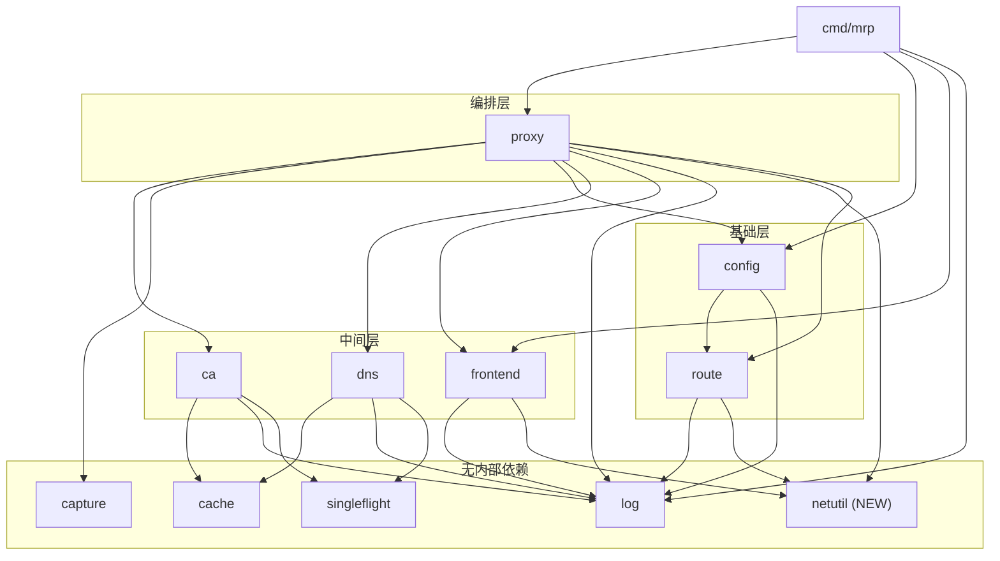
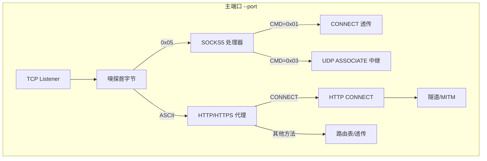
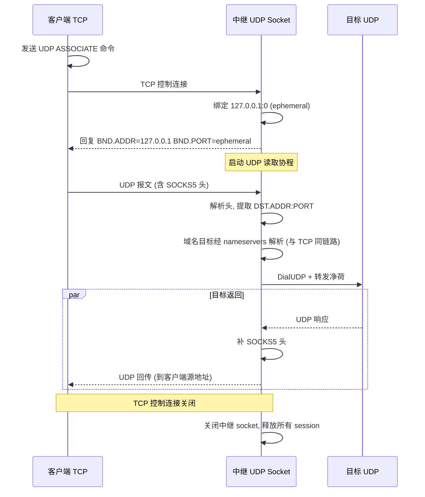

# SOCKS5 UDP ASSOCIATE & Refactor

Feature Name: udp-tcp-forwarding-refactor
Updated: 2026-11-13

## Description

扩展 mrp 至 UDP 领域：实现 SOCKS5 UDP ASSOCIATE，并在过程中提取共享的 dial+relay、Accept 循环与 buffer pool 为独立组件，消除重复代码。配置**仅支持 http(s) 协议**，不提供 TCP/UDP 端口转发（无 `forwards` 段）。

## Architecture

### 包依赖关系（重构后）



### 连接分发模型



### SOCKS5 UDP ASSOCIATE 时序



## Components and Interfaces

### 1. netutil 包（新建 `internal/netutil/netutil.go`）

提取三处共享逻辑为无内部依赖的基础包。

```go
// BufferPool 复用 32KB 拷贝缓冲，relay 与 ReverseProxy 共用
var BufferPool httputil.BufferPool

// Relay 在 client 与 upstream 之间双向搬运字节，任一方向结束即返回
func Relay(client, upstream net.Conn)

// ServeListener 在 listener 上 Accept 循环，每条连接启动 goroutine 调 handle，
// 连接计数经 connections 跟踪供优雅退出；Accept 临时错误退避重试
func ServeListener(listener net.Listener, handle func(net.Conn), connections *sync.WaitGroup) error

// UDPBufferSize 大于最大 UDP 载荷 65507 字节，SOCKS5 UDP 中继共用
const UDPBufferSize = 64 << 10
```

**迁移来源**：
- `BufferPool`：从 `route/handler.go` 移入，route 改为引用 `netutil.BufferPool`
- `Relay`：从 `proxy/connect.go` 移入，proxy 改为调用 `netutil.Relay`
- `ServeListener`：从 `frontend/frontend.go` 的 `Serve` 提取 Accept 循环，frontend 改为委托调用

### 2. SOCKS5 UDP ASSOCIATE（新建 `internal/proxy/socks_udp.go`）

```go
// serveSocks5UDP 处理 UDP ASSOCIATE 命令：绑定中继 socket，回复地址，
// 启动读取循环，阻塞至 TCP 控制连接关闭
func (p *Proxy) serveSocks5UDP(client net.Conn)

// socks5UDPRelay SOCKS5 UDP 中继
type socks5UDPRelay struct {
    conn       *net.UDPConn        // 绑定 127.0.0.1:0
    clientAddr atomic.Pointer[net.UDPAddr]  // 从首个报文学习
    sessions   map[string]*socks5UDPSession
    mu         sync.Mutex
}

// socks5UDPSession 一个客户端→目标方向的 UDP 会话
type socks5UDPSession struct {
    target *net.UDPConn            // dial 到目标
    relay  *socks5UDPRelay
    atyp   byte
    addr   []byte
    port   int
}
```

`socks.go` 重构为命令分发：`serveSocks5` 按 CONNECT/UDP ASSOCIATE 分流，拆分 `socks5ReadCommand`/`socks5ReadAddr`/`socks5DecodeHost`。

### 3. config 约束（修改 `internal/config/config.go`）

```go
// Config 顶层配置：Servers 为按域名分组的虚拟服务器，Nameservers 为上游域名解析用的 DNS 服务器。
type Config struct {
    Servers     []Server   `yaml:"servers"`
    Nameservers []string   `yaml:"nameservers"`
}

type Server struct {
    // ...其他字段...
    Protocol string `yaml:"protocol"` // 仅支持 HTTP/HTTPS 反向代理，不提供 TCP/UDP 端口转发
}
```

- `servers[].protocol` 仅 `http`/`https`，其余取值在加载阶段报错
- `forwards` 段被解析为未知字段（`KnownFields` 开启）而报错，从配置层面拒绝 TCP/UDP 转发
- `config.Load` 返回 `(*route.Table, []string, error)`：路由表 + DNS 服务器列表

### 4. proxy 重构（修改 `internal/proxy/`）

- `proxy.go`：移除 `forward.Manager`，`reload()` 只处理路由表与 DNS
- `connect.go`：`relay()` 删除，改用 `netutil.Relay`
- `socks.go`：`serveSocks5` 分发 CONNECT 与 UDP ASSOCIATE
- `socks_udp.go`（新）：UDP ASSOCIATE 全部逻辑

### 5. frontend 重构（修改 `internal/frontend/frontend.go`）

- `Serve` 的 Accept 循环提取为 `netutil.ServeListener`
- `Serve` 保留协议嗅探逻辑，委托 `netutil.ServeListener` 处理 Accept

### 6. main.go 启动流程

```go
func run(listener net.Listener, proxyInstance *proxy.Proxy) {
    var connections sync.WaitGroup
    go frontend.Serve(listener, proxyInstance.Handler(), proxyInstance.Socks5(), &connections)
    go proxyInstance.WatchFile(time.Second, nil)
    serveSignals(listener, proxyInstance, &connections, serveDone)
}
```

## Data Models

### SOCKS5 UDP 报文格式

```
+----+------+------+----------+----------+----------+
|RSV | RSV  | FRAG | ATYP     | DST.ADDR | DST.PORT | DATA      |
| 2B | 1B   | 1B   | variable | variable | 2B       | variable  |
+----+------+------+----------+----------+----------+
```

FRAG 非零丢弃（不支持分片）。

## Correctness Properties

1. **主端口行为不变**：未配置任何转发规则时，所有行为与当前版本完全一致。
2. **SOCKS5 UDP 绑定 127.0.0.1**：中继 socket 仅本地可达，防止外部滥用。
3. **热加载原子性**：`reload()` 串行化，路由表在锁内整体替换。
4. **优雅退出完整性**：主端口监听器关闭，连接计数统一 drain。
5. **BufferPool 兼容**：`netutil.BufferPool` 实现 `httputil.BufferPool` 接口，ReverseProxy 无感知。
6. **配置约束**：`forwards` 段与非法 `protocol` 在加载阶段报错，保留旧配置生效。

## Error Handling

| 场景 | 处理 |
|------|------|
| SOCKS5 UDP 中继 socket 绑定失败 | 回复 `0x01` General Failure，关闭 TCP 控制连接 |
| SOCKS5 UDP 会话目标不可达 | 单会话关闭，不影响中继与其他会话 |
| 配置 `forwards` 段或非法 protocol | `config.Load` 返回 error，保留旧配置 |

## Test Strategy

### netutil
- `Relay`：双向数据搬运正确性，半关闭行为
- `ServeListener`：Accept 退避重试、连接计数、监听器关闭退出
- `BufferPool`：复用一致性

### proxy SOCKS5 UDP
- UDP ASSOCIATE 握手：命令解析、中继地址回复
- UDP 报文转发：客户端→目标、目标→客户端
- FRAG 非零丢弃
- TCP 控制连接关闭后中继 socket 释放
- 空闲超时关闭

### config
- `forwards` 段被拒绝
- `servers[].protocol` 非法值被拒绝

### 回归
- 全部既有测试不变（`go test ./...`）
- `gofmt`、`go vet`、`staticcheck` 通过

## References

- RFC 1928: SOCKS Protocol Version 5
- `internal/proxy/connect.go` — relay 函数（已提取至 netutil）
- `internal/route/handler.go` — BufferPool（已提取至 netutil）
- `internal/frontend/frontend.go` — Serve Accept 循环（已提取至 netutil）
- `internal/proxy/socks.go` — SOCKS5 CONNECT（已扩展 UDP）
- `internal/config/config.go` — 配置结构（仅 http(s)）
