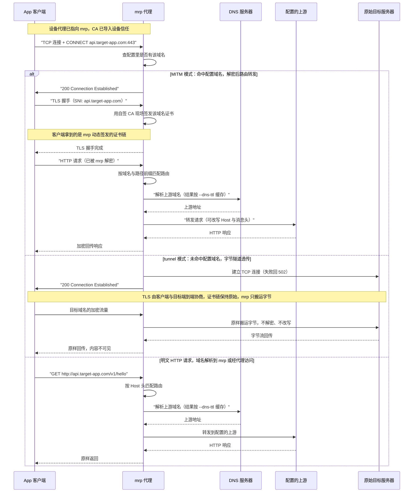

# My Reverse Proxy

Go 实现的本地反向代理，只监听一个端口（`--port`，默认 8000）。明文 HTTP 按 Host 头与路径前缀路由转发；HTTPS 经 CONNECT 进入，命中配置的域名做 MITM 解密后按同样规则路由，未命中的域名透传隧道。典型用途：

- 把移动 App 固定访问的域名劫持转发到自有服务器联调：可改写 Host 与请求/响应头，支持 `status` 短路响应与本地静态目录托管
- PC 无法直连部分地址时借道设备网络出口：mrp 跑在 Android / HarmonyOS 设备上，PC 经端口转发把代理指向设备
- 上游域名由 mrp 代为解析：配置了 `nameservers` 用配置的服务器，未配置按系统默认 DNS；配置文件修改自动热加载

## 原理

mrp 在 `--port` 上监听明文连接，协议由请求内容推导：绝对形式 HTTP 请求取 URL 主机、源形式请求取 Host 头；HTTPS 经 CONNECT 进入，目标是否命中 `servers` 配置的域名决定两种模式（日志标记 `mitm started` / `tunnel started`）：

| | MITM 模式（命中配置域名） | tunnel 模式（未命中配置域名） |
|------|------|------|
| TLS 握手 | mrp 用自签 CA 按目标域名现场签发证书，代替目标与客户端握手 | 客户端与目标服务器端到端握手，mrp 全程只搬运字节 |
| 客户端看到的证书链 | mrp 动态签发的证书链，需先导入并信任 `ca.crt` | 目标服务器的原始证书链，逐字节保持原样 |
| 请求内容可见性 | 可见可改：解密后按域名与路径前缀路由，可改写 Host 与消息头 | 不可见：mrp 仅知目标域名与端口，无法读取或改写内容 |
| 上游证书校验 | mrp 跳过，信任交由设备端信任的 CA 链路完成 | 无需 mrp 参与，证书校验本就发生在客户端与目标之间 |
| 未提供 CA 时 | 命中域名的 CONNECT 返回 502，无法解密 | 不受影响，仍正常透传 |

两种模式靠配置切换：`config.yaml` 的 `servers` 登记域名即对该域名走 MITM，删掉即回落 tunnel 透传，热加载即时生效；留空 `servers` 即全量 tunnel。

MITM 的关键在动态签发：客户端经 CONNECT 发来带 SNI 的 TLS ClientHello，mrp 用自签 CA 现场签发一张 SAN 为该 SNI 的服务端证书代替目标完成握手；客户端因信任导入的 CA 校验通过，mrp 由此得到明文 HTTP 再做路由转发，因此 CA 无需预登记拦截域名：



## 使用流程

### 1. 生成并导入 CA

生成一张自签 CA，mrp 用它按客户端 SNI 动态签发各域名的服务端证书：

```bash
openssl req -x509 -newkey ec -pkeyopt ec_paramgen_curve:P-256 \
  -keyout ca.key -out ca.crt -nodes -days 3650 \
  -subj "/CN=DeviceProxy CA" \
  -addext "basicConstraints=critical,CA:TRUE" \
  -addext "keyUsage=critical,keyCertSign,digitalSignature"
```

把 `ca.crt` 导入客户端，使其信任 mrp 签发的证书。仅 MITM 模式需要，纯 tunnel 透传可跳过。

#### Android

- **用户证书**：设置 → 安全 → 更多安全设置 → 加密与凭据 → 安装证书 → CA 证书。用户证书仅对信任用户 CA 的应用生效；Android 7.0+ 应用默认只信任系统证书，需在应用侧放行用户证书（`network_security_config` 的 `trust-anchors` 加入 `user`）
- **系统证书（需 Root）**：将证书命名为 `<subject_hash>.0`，推送到 `/system/etc/security/cacerts/`：

  ```bash
  HASH=$(openssl x509 -subject_hash_old -in ca.crt | head -1)

  # adbd 以 root 运行并重新挂载 /system 为可写
  adb root
  adb remount

  # 直接推送到系统证书目录
  adb push ca.crt /system/etc/security/cacerts/${HASH}.0
  adb shell chmod 644 /system/etc/security/cacerts/${HASH}.0
  ```

#### HarmonyOS

OpenHarmony 系统 CA 证书位于 `/etc/security/certificates`，开发者模式（或 Root）下可直接推送，命名沿用 `<subject_hash>.0`：

```bash
HASH=$(openssl x509 -subject_hash_old -in ca.crt | head -1)
hdc file send ${HASH}.0 /etc/security/certificates
```

#### Windows

```bat
rem 当前用户（免管理员）
certutil -user -addstore Root ca.crt

rem 或机器全局（需管理员）
certutil -addstore Root ca.crt
```

#### Linux

```bash
# Debian / Ubuntu：装入系统信任并刷新
sudo cp ca.crt /usr/local/share/ca-certificates/mrp-ca.crt
sudo update-ca-certificates
```

也可以用 `curl --cacert ca.crt` 临时信任，无需系统导入。

### 2. 编写配置

mrp 首次运行会自动在当前目录创建 `config.yaml`（含注释模板），按需编辑：

```yaml
# 上游域名解析用的 DNS 服务器（首启模板自带这两组）；删除本字段按系统默认 DNS 解析
nameservers:
  - "114.114.114.114"
  - "8.8.8.8"
# 每条 server 是一个虚拟服务器：mrp 只监听一个端口（--port），protocol 与 port
# 只用于决定哪个请求归属该 server，不参与监听。protocol 省略匹配任意协议，
# port 省略匹配任意端口；同一域名可声明多个 server 分别匹配不同协议与端口
servers:
  - domain: api.target-app.com
    routes:
      - prefix: /v1/
        upstream: https://api.our-server.com/v1/
        host: api.our-server.com
        headers:
          request:
            Authorization: "Bearer token"
          response:
            Access-Control-Allow-Origin: "*"
            Access-Control-Allow-Methods: "GET, POST, OPTIONS"
      - prefix: /assets/
        upstream: ./dist
      - prefix: /
        upstream: http://192.168.1.50:8080
  - domain: admin.target-app.com
    routes:
      - prefix: /health
        status: 200
        body: OK
      - prefix: /
        upstream: http://127.0.0.1:9000
```

字段说明：

| 字段 | 说明 |
|------|------|
| `servers[].domain` | 按域名匹配（大小写不敏感），HTTPS 用 CONNECT 目标主机、HTTP 用 Host 头 |
| `servers[].protocol` | 可选，`http` 或 `https`，省略匹配任意协议 |
| `servers[].port` | 可选，请求目标端口，省略匹配任意端口 |
| `routes[].prefix` | 最长路径前缀匹配，必须以 `/` 开头 |
| `routes[].upstream` | 上游地址，路径前缀自动映射；也支持本地目录路径（相对进程工作目录，托起静态文件，目录命中回退 `index.html`）；与 `status` 互斥 |
| `routes[].status` | 可选，直接返回该状态码，不转发到 `upstream`；取值 200-599，其中 204/304 不得携带 `body`；与 `upstream` 互斥 |
| `routes[].body` | 可选，`status` 模式下的响应体；默认 `Content-Type: text/plain; charset=utf-8`，可通过 `headers.response` 覆盖 |
| `routes[].host` | 可选，改写转发时的 Host 头 |
| `routes[].headers.request` | 可选，改写发往上游的请求头（Set 语义，覆盖同名已有值） |
| `routes[].headers.response` | 可选，覆盖下游返回的响应头（如跨域校验头 `Access-Control-Allow-*`） |
| `nameservers` | 上游域名解析的 DNS 服务器列表；支持裸 IP（默认 53 端口）与 `host:port`、`[::1]:5353` 写法，按顺序故障切换，单次尝试超时由 `--dns-timeout` 控制；解析结果按 `--dns-ttl` 缓存，`nameservers` 或路由变更时清空。省略或留空时按系统默认 DNS 解析（读 `/etc/resolv.conf`） |

Android / HarmonyOS 设备上的 `/etc/resolv.conf` 常把 nameserver 指向 `[::1]` 或网关等非标准地址（解析交给 netd 等守护进程完成），走系统默认 DNS 时上游域名解析会失败，报 `read udp ...->[::1]:53: connection refused`。首启模板已自带 `114.114.114.114` 与 `8.8.8.8`，设备部署应保留显式配置。

修改 `config.yaml` 后自动热加载（轮询文件变更，`SIGHUP` 手动触发亦可）：路由或 `nameservers` 变化时重建转发、清空 DNS 解析缓存与已签发证书缓存，改注释不打断已有连接；CA 证书仅在启动时加载一次。

### 3. 启动

从 GitHub Releases 下载对应平台的静态二进制，免本地编译（`latest` 为每次构建自动发布的预发布包，`v*` 为正式版）：

```bash
# Linux / HarmonyOS / Android 设备本机（linux/arm64 静态产物）
wget https://github.com/isunk/MyReverseProxy/releases/download/latest/mrp-linux-arm64

# Windows（amd64）
curl -LO https://github.com/isunk/MyReverseProxy/releases/download/latest/mrp-windows-amd64.exe

# Windows 可视化部署面板（可选，内置固定 CA，无需 openssl）
curl -LO https://github.com/isunk/MyReverseProxy/releases/download/latest/mrp.hta
```

在 `--port` 指定的端口（默认 8000）监听，加载工作目录下的 `ca.crt` / `ca.key`：

```bash
# Linux / HarmonyOS / Android 设备本机
chmod +x mrp-linux-arm64
./mrp-linux-arm64
```

Windows 命令行运行 `mrp-windows-amd64.exe` 即可；也可双击 `mrp.hta`（MRP Helper 部署面板）：内置固定 CA 免 openssl，提供 Windows 侧 CA 导入、进程启停、系统代理设置，以及 Android(adb) / HarmonyOS(hdc) 设备的安装、启动、配置同步与卸载，设备工作目录统一为 `/data/local/mrp`。

命令行参数：

| 参数 | 默认 | 说明 |
|------|------|------|
| `--port` | `8000` | 唯一监听端口 1-65535，须与客户端代理端口一致；默认值无需管理员或 root 权限 |
| `--config` | `config.yaml` | 路由配置文件路径；未指定时缺失则自动创建 |
| `--cert` / `--key` | `ca.crt` / `ca.key` | CA 证书/私钥，成对提供；缺省时无法 MITM，命中配置的 CONNECT 返回 502 |
| `--log` | `info` | debug / info / warn / error |
| `--dns-timeout` | `1s` | 单个 DNS 服务器的解析尝试超时，超时后切到下一个 `nameservers` |
| `--dns-ttl` | `30s` | 上游 `host:port` 解析结果的缓存时长，`0` 关闭缓存改为每次连接都解析 |

### 4. 验证

```bash
# 显式代理：CONNECT 命中配置域名则 MITM 后路由转发
curl -x http://127.0.0.1:8000 --cacert ca.crt \
  https://api.target-app.com/v1/hello

# 显式代理：CONNECT 未命中配置域名则透传隧道（无需 cacert）
curl -x http://127.0.0.1:8000 https://www.example.com/

# 直连：域名解析到 mrp 监听端口，按 Host 头路由转发
curl --resolve api.target-app.com:8000:127.0.0.1 \
  http://api.target-app.com:8000/v1/hello
```

观察 mrp 日志确认路由命中与转发结果：每条请求打印 `domain` / `protocol` / `port` / `path` / `status` / `elapsed`，CONNECT 额外打印 `mitm started` 或 `tunnel started domain=... port=...`；上游不可达时返回 502。日志格式为 `MM-dd HH:mm:ss.SSS\t级别\t消息+参数`，按级别着色，重定向到文件时为纯文本。

### 5. 设备对接代理

mrp 可跑在设备本机（代理地址填 `127.0.0.1`，免局域网依赖），也可跑在 PC 上（代理地址填 PC 的局域网 IP）。监听端口由 `--port` 指定（默认 8000），须与代理地址端口一致。

#### Android

```bash
# --- 设备本机运行（linux/arm64 静态产物，Android 直接执行） ---
adb shell mkdir -p /data/local/mrp
adb push mrp-linux-arm64 /data/local/mrp/

# MITM 所需 CA 文件与路由配置，按需推送
adb push ca.key ca.crt config.yaml /data/local/mrp/
adb shell chmod +x /data/local/mrp/mrp-linux-arm64

# 前台输出日志，Ctrl+C 结束
adb shell "cd /data/local/mrp && ./mrp-linux-arm64"

# 全局代理指向本机（mrp 跑在 PC 上时换成 PC 的局域网 IP）
adb shell settings put global http_proxy 127.0.0.1:8000

# 取消代理
adb shell settings put global http_proxy :0
```

部分 App 自实现网络栈、忽略系统代理，这类 App 需改用 hosts / DNS 重定向方式。

#### HarmonyOS

```bash
# --- mrp 跑在设备本机（linux/arm64 静态产物） ---
hdc shell mkdir -p /data/local/mrp
hdc file send ca.key /data/local/mrp/
hdc file send ca.crt /data/local/mrp/

# 路由配置，按需推送
hdc file send config.yaml /data/local/mrp/
hdc file send mrp-linux-arm64 /data/local/mrp/
hdc shell "chmod +x /data/local/mrp/mrp-linux-arm64"

# 运行（前台输出日志，Ctrl+C 结束）
hdc shell "cd /data/local/mrp && ./mrp-linux-arm64"

# 全局代理指向本机
hdc shell network-cfg set http_proxy 127.0.0.1:8000

# 取消代理
hdc shell network-cfg set http_proxy 0
```

#### Windows

```bat
rem 设置 WinHTTP 系统代理（服务与部分命令行工具生效）
netsh winhttp set proxy 192.168.1.100:8000

rem 取消代理
netsh winhttp reset proxy
```

浏览器与多数桌面应用走 WinINET：设置 → 网络和 Internet → 代理 → 手动设置代理，填入 `192.168.1.100:8000`，关闭时切回「自动检测」。也可以只让单个 Chrome 实例走代理（不影响系统设置，关闭窗口即结束）：

```bash
"C:\Program Files\Google\Chrome\Application\chrome.exe" --proxy-server="http://127.0.0.1:8000" "https://api.target-app.com/v1/"
```

#### Linux

```bash
# 设置会话级代理（curl 等命令行工具生效）
export http_proxy=http://192.168.1.100:8000 https_proxy=http://192.168.1.100:8000

# 取消代理
unset http_proxy https_proxy
```

### 6. PC 借道设备网络出口（端口转发）

PC 所在网络访问不了部分地址、设备可直连时，把 mrp 跑在设备上，用端口转发把 PC 本地端口映射到设备端口，PC 应用把代理指向 `127.0.0.1:<端口>`，请求即改从设备网络出口发出，上游域名解析（`nameservers`）也在设备侧完成。

```bash
# --- Android（adb）：PC 本地端口 -> 设备端口 ---
adb forward tcp:8000 tcp:8000

# 查看已建立的转发
adb forward --list

# 移除
adb forward --remove tcp:8000

# --- HarmonyOS（hdc）---
hdc fport tcp:8000 tcp:8000

# 查看已建立的转发
hdc fport ls

# 移除
hdc fport rm tcp:8000 tcp:8000
```

设备侧推文件与启动见上一节 Android / HarmonyOS 小节；PC 侧代理指向 `127.0.0.1:8000`，设置方式与上文 Windows / Linux 小节相同（地址换成 `127.0.0.1`）。

使用要点：

- `config.yaml` 初始留空 `servers` 即全量 tunnel：PC 侧无需导入 CA；仅命中路由的域名才做 MITM
- 转发随设备连接存活，USB 断开或设备重连后需重新执行
- 无视系统代理的应用需 Proxifier 类工具强制接管；PC 侧改 hosts / DNS 对此场景无效，出口流量仍需经代理从设备发出

## 从源码构建

需要 Go 1.25+。克隆后直接编译：

```bash
go build -o mrp ./cmd/mrp
```

交叉编译静态二进制（`CGO_ENABLED=0`）：

```bash
# Android / Linux arm64 设备
CGO_ENABLED=0 GOOS=linux GOARCH=arm64 go build -trimpath -ldflags "-s -w" -o mrp-linux-arm64 ./cmd/mrp

# Windows amd64
CGO_ENABLED=0 GOOS=windows GOARCH=amd64 go build -trimpath -ldflags "-s -w" -o mrp-windows-amd64.exe ./cmd/mrp
```

运行测试：

```bash
go test ./...
go test -race ./internal/ca/ ./internal/proxy/
```

## 项目结构

```
cmd/mrp/        入口：命令行解析、信号处理、构建代理实例
internal/
  config/       YAML 配置结构与解析
  route/        路由表、前缀匹配、路径改写（含编码保真）
  proxy/        反向代理核心：请求转发、CONNECT 隧道、MITM 编排、热加载
  frontend/     单端口明文监听、单连接复用（MITM 内层服务）
  ca/           自签 CA 按名字现场签发证书（域名 SAN / IP SAN），并发合并
  dns/          上游 DNS 解析与故障切换、结果缓存
  cache/        通用并发缓存
  log/          控制台日志（级别过滤、按级别着色）
  testutil/     跨包共享测试替身
```
