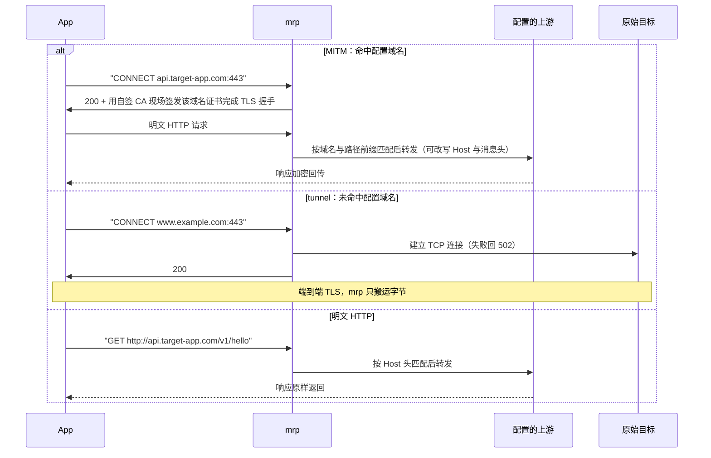

# My Reverse Proxy

Go 实现的单端口反向代理（`--port`，默认 8000）。明文 HTTP 按 Host 头与路径前缀路由；HTTPS 经 CONNECT 进入，命中配置域名则 MITM 解密后按同样规则路由，未命中则透传隧道。

- 劫持 App 固定访问的域名转发到自有服务器联调：可改写 Host 与请求/响应头，支持 `status` 短路与本地静态目录
- PC 无法直连时借道设备网络出口：mrp 跑在 Android / HarmonyOS 上，PC 经端口转发指向设备
- 上游域名由 mrp 代解析（`nameservers`），配置修改自动热加载

## 原理

协议由请求内容推导：绝对形式 HTTP 取 URL 主机、源形式取 Host 头。HTTPS 经 CONNECT 进入，按 CONNECT 目标是否命中 `servers` 分两种模式：

| | MITM（命中域名） | tunnel（未命中） |
|------|------|------|
| TLS 握手 | mrp 用自签 CA 现场签发证书代替目标握手 | 客户端与目标端到端握手 |
| 客户端看到的证书链 | mrp 动态签发，需导入信任 `ca.crt` | 目标原始证书，逐字节原样 |
| 请求内容 | 可见可改，按域名与路径前缀路由 | 不可见，仅知目标域名与端口 |
| 上游证书校验 | mrp 跳过 | 客户端与目标间完成 |
| 未提供 CA 时 | 返回 502 | 正常透传 |

MITM 靠动态签发：客户端经 CONNECT 发来带 SNI 的 TLS ClientHello，mrp 用自签 CA 现场签发 SAN 为该 SNI 的证书完成握手，得到明文 HTTP 再路由，CA 无需预登记域名。`servers` 登记域名即 MITM，删掉回落 tunnel，热加载即时生效；留空 `servers` 即全量 tunnel。



## 使用流程

### 1. 生成并导入 CA

仅 MITM 需要，纯 tunnel 可跳过。

```bash
openssl req -x509 -newkey ec -pkeyopt ec_paramgen_curve:P-256 \
  -keyout ca.key -out ca.crt -nodes -days 3650 \
  -subj "/CN=DeviceProxy CA" \
  -addext "basicConstraints=critical,CA:TRUE" \
  -addext "keyUsage=critical,keyCertSign,digitalSignature"
```

- **Android（用户证书）**：设置 → 加密与凭据 → 安装 CA 证书。Android 7.0+ 应用默认只信系统证书，需应用侧 `network_security_config` 的 `trust-anchors` 加入 `user`；Root 设备可装为系统证书：

  ```bash
  HASH=$(openssl x509 -subject_hash_old -in ca.crt | head -1)
  adb root && adb remount
  adb push ca.crt /system/etc/security/cacerts/${HASH}.0
  adb shell chmod 644 /system/etc/security/cacerts/${HASH}.0
  ```

- **HarmonyOS**：开发者模式（或 Root）推送 `/etc/security/certificates`，命名 `<subject_hash>.0`：

  ```bash
  hdc file send ${HASH}.0 /etc/security/certificates
  ```

- **Windows**：`certutil -user -addstore Root ca.crt`
- **Linux**：

  ```bash
  sudo cp ca.crt /usr/local/share/ca-certificates/mrp-ca.crt
  sudo update-ca-certificates
  ```

  临时信任：`curl --cacert ca.crt`

### 2. 编写配置

首次运行自动创建 `mrp.yaml`（含注释模板）。

```yaml
# 上游域名解析用 DNS；删除本字段按系统默认解析
nameservers:
  - "114.114.114.114"
  - "8.8.8.8"
# protocol / port 只参与虚拟服务器匹配，省略匹配任意；mrp 只监听 --port
servers:
  - domain: api.target-app.com
    routes:
      - prefix: /v1/
        upstream: https://api.our-server.com/v1/
        host: api.our-server.com
        headers:
          request:
            Authorization: "Bearer token"
          response:
            Access-Control-Allow-Origin: "*"
      - prefix: /assets/
        upstream: ./dist
      - prefix: /
        upstream: http://192.168.1.50:8080
  - domain: admin.target-app.com
    routes:
      - prefix: /health
        status: 200
        body: OK
      - prefix: /
        upstream: http://127.0.0.1:9000
```

| 字段 | 说明 |
|------|------|
| `servers[].domain` | 按域名匹配，HTTPS 取 CONNECT 目标主机、HTTP 取 Host 头 |
| `servers[].protocol` / `.port` | 可选，`http` / `https` 与请求目标端口，省略匹配任意 |
| `routes[].prefix` | 最长路径前缀匹配，以 `/` 开头 |
| `routes[].upstream` | 上游地址或本地目录（静态托管，目录命中回退 `index.html`）；与 `status` 互斥 |
| `routes[].status` | 200-599，短路响应；204/304 不得带 `body`；与 `upstream` 互斥 |
| `routes[].body` | 响应体，默认 `Content-Type: text/plain; charset=utf-8`，可用 `headers.response` 覆盖 |
| `routes[].host` | 改写转发时的 Host 头 |
| `routes[].headers.request` / `.response` | 覆盖发往上游的请求头 / 下游返回的响应头 |
| `nameservers` | DNS 列表，裸 IP 或 `host:port`，按序故障切换；解析结果按 `--dns-ttl` 缓存 |

设备上 `/etc/resolv.conf` 常把 nameserver 指向 `[::1]` 等非标准地址，走系统 DNS 会导致上游解析失败，设备部署应保留显式 `nameservers`。

配置修改自动热加载（轮询变更或 `SIGHUP`）：路由或 `nameservers` 变化时重建转发并清空 DNS 与已签发证书缓存；CA 仅启动时加载一次。

### 3. 启动

从 [Releases](https://github.com/isunk/MyReverseProxy/releases) 下载对应平台二进制（`latest` 为每次构建自动发布的预发布包，`v*` 为正式版），在 `--port`（默认 8000）监听，加载工作目录下的 `ca.crt` / `ca.key`：

```bash
./mrp-linux-arm64       # Linux / HarmonyOS / Android
mrp-windows-amd64.exe   # Windows
```

Windows 也可双击 `mrp.hta` 部署面板：内置固定 CA 免 openssl，提供 Windows 侧 CA 导入、进程启停、系统代理设置，及 Android(adb) / HarmonyOS(hdc) 设备的安装、启动、配置同步与卸载，设备工作目录 `/data/local/mrp`。

| 参数 | 默认 | 说明 |
|------|------|------|
| `--port` | `8000` | 唯一监听端口，须与客户端代理端口一致 |
| `--config` | `mrp.yaml` | 路由配置文件，未指定时缺失则自动创建 |
| `--cert` / `--key` | `ca.crt` / `ca.key` | CA 证书/私钥，缺省时无法 MITM，命中配置的 CONNECT 返回 502 |
| `--log` | `info` | debug / info / warn / error |
| `--dns-timeout` | `1s` | 单个 DNS 解析尝试超时，超时切下一个 |
| `--dns-ttl` | `30s` | 解析结果缓存时长，`0` 关闭 |

### 4. 验证

```bash
# 显式代理：命中配置域名则 MITM 后转发
curl -x http://127.0.0.1:8000 --cacert ca.crt https://api.target-app.com/v1/hello

# 显式代理：未命中则透传隧道
curl -x http://127.0.0.1:8000 https://www.example.com/

# 直连：域名解析到监听端口，按 Host 头路由
curl --resolve api.target-app.com:8000:127.0.0.1 http://api.target-app.com:8000/v1/hello
```

每条请求日志打印 `domain` / `protocol` / `port` / `path` / `status` / `elapsed`，CONNECT 标记 `mitm started` / `tunnel started`；上游不可达返回 502。

### 5. 设备对接代理

mrp 跑设备本机（代理填 `127.0.0.1`）或 PC（填 PC 局域网 IP），端口须与代理一致。

#### Android

```bash
adb shell mkdir -p /data/local/mrp
adb push mrp-linux-arm64 ca.key ca.crt mrp.yaml /data/local/mrp/
adb shell chmod +x /data/local/mrp/mrp-linux-arm64

# 前台运行输出日志
adb shell "cd /data/local/mrp && ./mrp-linux-arm64"

# 全局代理指向本机；取消改 :0
adb shell settings put global http_proxy 127.0.0.1:8000
```

#### HarmonyOS

```bash
hdc shell mkdir -p /data/local/mrp
hdc file send mrp-linux-arm64 ca.key ca.crt mrp.yaml /data/local/mrp/
hdc shell "chmod +x /data/local/mrp/mrp-linux-arm64 && cd /data/local/mrp && ./mrp-linux-arm64"

# 全局代理指向本机；取消改 0
hdc shell network-cfg set http_proxy 127.0.0.1:8000
```

#### Windows

```bat
rem 系统代理（服务与部分命令行工具生效）；取消 reset proxy
netsh winhttp set proxy 192.168.1.100:8000
```

浏览器与多数桌面应用走 WinINET：设置 → 网络和 Internet → 代理。或单实例 Chrome：

```bash
"C:\Program Files\Google\Chrome\Application\chrome.exe" --proxy-server="http://127.0.0.1:8000" "https://api.target-app.com/v1/"
```

#### Linux

```bash
export http_proxy=http://192.168.1.100:8000 https_proxy=http://192.168.1.100:8000
```

### 6. PC 借道设备网络出口

mrp 跑在设备上，PC 建立端口转发后把代理指向 `127.0.0.1:<端口>`，流量改从设备出口发出，上游 DNS 解析也在设备侧完成。

```bash
adb forward tcp:8000 tcp:8000    # HarmonyOS：hdc fport tcp:8000 tcp:8000
```

- 初始留空 `servers` 全量 tunnel，PC 侧无需导入 CA
- 转发随设备连接存活，断开或重连后需重新执行
- 无视系统代理的应用需 Proxifier 类工具强制接管，改 hosts / DNS 对此无效

## 从源码构建

Go 1.25+：

```bash
go build -o mrp ./cmd/mrp

# 交叉编译静态二进制
CGO_ENABLED=0 GOOS=linux GOARCH=arm64 go build -trimpath -ldflags "-s -w" -o mrp-linux-arm64 ./cmd/mrp
CGO_ENABLED=0 GOOS=windows GOARCH=amd64 go build -trimpath -ldflags "-s -w" -o mrp-windows-amd64.exe ./cmd/mrp

go test ./...
go test -race ./internal/ca/ ./internal/proxy/
```

## 项目结构

```
cmd/mrp/        入口：命令行解析、信号处理、构建代理实例
internal/
  config/       YAML 配置结构与解析
  route/        路由表、前缀匹配、路径改写（含编码保真）
  proxy/        反向代理核心：请求转发、CONNECT 隧道、MITM 编排、热加载
  frontend/     单端口明文监听、单连接复用（MITM 内层服务）
  ca/           自签 CA 按名字现场签发证书（域名 SAN / IP SAN），并发合并
  dns/          上游 DNS 解析与故障切换、结果缓存
  cache/        通用并发缓存
  log/          控制台日志（级别过滤、按级别着色）
  testutil/     跨包共享测试替身
```
